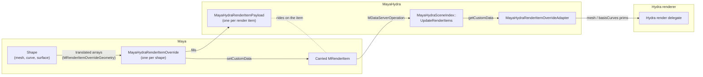

# Render item override

This document describes the render item override path in MayaHydra as of
November 2026. For the stock render item data flow it replaces
(`MRenderOverride`, `MDataServerOperation`, render item adapters), read
[mayaHydraDetails.md](mayaHydraDetails.md) first. For how GPU-deformed
geometry reaches the renderer without a readback, see
[gpuBufferSharing.md](gpuBufferSharing.md).

The render item override path lets Maya hand MayaHydra the geometry Viewport
2.0 (VP2) has already translated for a shape, without VP2 building any of its
own drawing structures for it: no vertex or index buffers, no shader binding,
no consolidation. MayaHydra is the only one drawing those shapes, so the work
VP2 would do to draw them itself is skipped.

## Overview

On the stock path, VP2 translates every shape into render items, uploads their
geometry to its own GPU buffers, and MayaHydra reads those buffers back
through `MGeometry` in `MayaHydraRenderItemAdapter::UpdateFromDelta`.

On the render item override path, MayaHydra registers an
`MPxRenderItemOverride` creator for the shape types it carries. For each
carried shape, Maya creates render items with the names VP2 would have used
(`StandardShadedItem`, `DormantPolyWire`, ...) but builds no drawing data for
them. Instead it calls the override's `updateRenderItem()` with a read-only
view of the translated arrays (`MRenderItemOverrideGeometry`). The override
copies or borrows those arrays into a `MayaHydraRenderItemPayload` and attaches
it to the item as custom data. The items then reach MayaHydra through the same
`MDataServerOperation` as every other render item, and the scene index serves
each one through a `MayaHydraRenderItemOverrideAdapter`.

We call such a render item a **carrier**: it carries geometry to MayaHydra
instead of being drawn by VP2.

Everything downstream of the adapter (picking, selection highlighting,
materials, bounding boxes, removal) is the code the stock path already uses.
Only the geometry translation is different.

## Components

| Component | File | Role |
| --- | --- | --- |
| Build detection | `cmake/modules/FindMaya.cmake` | Defines `MAYA_HAS_RENDER_ITEM_OVERRIDE_PRIVATE` when Maya ships `maya/MPxRenderItemOverridePrivate.h` |
| Registration | `mayaPlugin/plugin.cpp` | Registers the creator for every carried draw classification, and tells the scene index |
| Override and creator | `adapters/renderItemOverrideCreator.{h,cpp}` | `MayaHydraRenderItemOverride`: turns `MRenderItemOverrideGeometry` into a payload |
| Payload | `adapters/renderItemPayload.h` | `MayaHydraRenderItemPayload`: the arrays one render item carries, as `MUserData` |
| Adapter | `adapters/renderItemOverrideAdapter.{h,cpp}` | Serves a payload to Hydra and emits the dirty notifications |
| Harvest | `sceneIndex/mayaHydraSceneIndex.cpp` | `UpdateRenderItems` detects carriers, creates their adapters, resolves materials and geomSubsets |
| Settings | `mayaPlugin/envSettings.{h,cpp}` | `MAYAHYDRA_RENDER_ITEM_OVERRIDE` |

All paths above are relative to `lib/mayaHydra/hydraExtensions/`, except the
CMake module and the `mayaPlugin/` files.

### The Maya API

`MPxRenderItemOverride` is a **private, unsupported** Maya API. It is not part
of the documented OpenMaya API, and it may change in any Maya release without
deprecation.

The API has three classes:

| Class | Role |
| --- | --- |
| `MRenderItemOverrideRegistry` | Static `registerOverrideCreator` / `deregisterOverrideCreator`, keyed by draw classification and registrant ID |
| `MPxRenderItemOverride` | The plugin's per-shape object: `updateRenderItem()` plus two capability queries |
| `MRenderItemOverrideGeometry` | A borrowed, read-only view of the translated arrays for one render item, valid for one call |

### Build-time gating

The whole path is compiled only when `FindMaya.cmake` finds
`maya/MPxRenderItemOverridePrivate.h` in the Maya devkit. It then sets
`MAYA_HAS_RENDER_ITEM_OVERRIDE_PRIVATE`, which `hydraExtensions` and
`mayaPlugin` add as a compile definition. Without it, the creator compiles to
nothing, the plugin registers nothing, and MayaHydra runs the stock path
whatever `MAYAHYDRA_RENDER_ITEM_OVERRIDE` says.

### Runtime settings

| Setting | Default | Meaning |
| --- | --- | --- |
| `MAYAHYDRA_RENDER_ITEM_OVERRIDE` | `true` | Master switch. `0` skips registration, so every shape takes the stock path |
| `MAYAHYDRA_MOTION_SAMPLING_MODE` | unset (evaluate) | `velocity` selects velocity motion samples; decides which shutter samples are requested (see [Motion blur](#motion-blur)) |
| `MAYAHYDRA_GPU_BUFFER_SHARING` | `true` | Needed for GPU-deformed carriers to stay on the GPU (see [GPU-deformed shapes](#gpu-deformed-shapes)) |

`MAYAHYDRA_RENDER_ITEM_OVERRIDE` is read once, when the plugin loads.

## Registration

`initializePlugin` calls `registerRenderItemOverride()` as its **last** step.
Maya does not call `uninitializePlugin` after a failed `initializePlugin`, so a
registration made before a later failure would be left pointing into an
unloaded module.

The creator is registered for every classification in
`MayaHydraRenderItemOverrideCreator::drawClassifications()`:

| Draw classification | Carried as |
| --- | --- |
| `drawdb/geometry/mesh` | Shaded mesh + wireframe |
| `drawdb/geometry/nurbsSurface` | Shaded mesh + isoparm wireframe |
| `drawdb/geometry/subdiv` | Shaded mesh, plus the line items VP2 makes for it |
| `drawdb/geometry/nurbsCurve` | Curve |
| `drawdb/geometry/bezierCurve` | Curve |

Each call passes:

- the registrant ID `mayaHydra`;
- `requiresRenderOverride = true`: what MayaHydra carries is drawn only by its
  render override, so Maya carries shapes only while the viewport is in render
  override mode (Global Hydra, the `mayaUseHydra` optionVar) and draws them
  with VP2 otherwise;
- `MayaHydraRenderItemOverrideCreator::shutterSamples()`, which is fixed for
  the registration (see [Motion blur](#motion-blur)).

Registration is **all or nothing**. If one classification fails, the ones
already registered are deregistered again, so no shape type is left carried
while the others are not. On success the plugin calls
`MayaHydraSceneIndex::SetRenderItemOverrideEnabled(true)`. The scene index
keys on that flag, not on the environment setting, so the stock path never
pays for a `getCustomData()` probe per render item.

Each registration and deregistration rebuilds Maya's scene, since shapes
already in it were classified before. `uninitializePlugin` deregisters
**first**, before anything else is torn down, so Maya never calls into a
module that is unloading.

Maya republishes every carried item with full change flags when the render
override changes, just as it does for stock render items. The only thing
MayaHydra does on a switch is republish whether the new renderer binds device
streams (`MhExtGpuStreams::SetRendererBindsDeviceStreams`, from
`MtohRenderOverride::setup` and `_InitHydraResources`); `supportsGPUVertexBuffer()`
picks that up on the next publish.

## The override

`MayaHydraRenderItemOverride` (in `renderItemOverrideCreator.cpp`) is created
once per carried shape. Its creator never declines: the render item override
path is a whole-viewport mode, so a declined shape would simply be missing from
the Hydra viewport. Returning null from the creator is where a per-shape filter
would go.

### Render items per shape

A shape is carried as the render items VP2 would have made for it, each with
its own payload, visibility and change flags. `MRenderItemOverrideGeometry::kind()`
says which one an item is, and maps onto `MayaHydraRenderItemPayload::Kind`:

| Kind | Arrays | Hydra prim |
| --- | --- | --- |
| `kShadedMesh` | points, normals, UVs, face counts and indices, polygon-to-face map, shutter points | `HdMesh` |
| `kWireframe` | points, edge index pairs | `HdBasisCurves`, `segmented` |
| `kCurve` | points, edge index pairs | `HdBasisCurves`, `nonperiodic` when the edges form one chain |
| `kBoundingBox` | eight corners, twelve edges | `HdBasisCurves`, `segmented` |

The shaded and wireframe items are separate so that states like "wireframe
visible, shaded hidden" in a wireframe-only panel work, exactly as they do for
VP2's own items. Both share one points array (see [Copies](#copies)), so the
wireframe costs no extra vertex memory. A curve is kept apart from a wireframe
because it is the object, not decoration on one: it draws in a shaded
viewport, it is selectable, and it owns its DAG identity.

### The geometry layout

The arrays use VP2's own "render vertex" layout. Points, normals and UVs are
all vertex-interpolated over one array, and vertices are already split wherever
a normal or UV is discontinuous. Hard edges and UV seams are therefore carried
by the layout rather than by face-varying primvars, and the arrays map onto
Hydra with no re-indexing.

The faces are VP2's triangulation, not Maya's polygons. `polygonFaceOffsets`
maps each Maya polygon to the faces it became, which is what lets per-face
shading assignments become geomSubsets (see [Materials](#materials)).

With smooth mesh preview on, the arrays are Maya's own subdivided mesh. The
adapter therefore always publishes `subdivisionScheme = none`, so Hydra does
not subdivide a second time.

### updateRenderItem

The first call for an item has `MVS_new | MVS_changedGeometry | MVS_changedTopo`
set. The override builds a payload and attaches it with
`MRenderItem::setCustomData()`. Attaching nothing **declines** the item for
now, and Maya asks again later. The override declines when:

- the geometry is empty (`vertexCount() == 0`), which means "not ready yet";
- a line item has no edges to draw.

There is deliberately no `MFnMesh` fallback for empty geometry: it would
silently regress to the faceted base cage.

Later calls read the payload back with `getCustomData()` and update it in
place:

- The DAG path is refreshed when it changed (reparenting moves the path, not
  the object). It is compared first, because copying an `MDagPath` writes node
  reference counts, and updates may run on many threads at once.
- Geometry is refreshed **only** when `MVS_changedGeometry` or
  `MVS_changedTopo` is set. A presentation-only update (visibility, matrix,
  wireframe colour) carries no geometry, and reading it would clear the
  arrays.
- Face counts, face indices and edges are refreshed only on `MVS_changedTopo`.
- UVs are refreshed only on a topology change or when
  `MRenderItemOverrideGeometry::uvsChanged()` is true. Deformation never moves
  UVs, and copying them every frame for every deforming mesh was a large share
  of the per-frame cost.
- An update with geometry flags and an empty view means the shape was emptied
  (not that it is unready, since the item was created with geometry). Every
  array is cleared so the prim stops drawing.

Transform, visibility, wireframe colour, material and all dirty notifications
are left to the adapter: they need the scene index, which an override cannot
see.

### Copies

Per-frame array conversion is the dominant cost of a carried scene, so the
override avoids copies wherever the API allows:

- **Lent buffers.** `positionsBuffer()`, `normalsBuffer()`, `uvsBuffer()` and
  the index buffer accessors return a shared-ownership handle when Maya can
  lend the memory. The override wraps the handle in a `VtArray` foreign data
  source (`LentBuffer`), so the payload, Hydra and the renderer all read Maya's
  memory directly. When the last `VtArray` goes, the handle is released. Maya
  never writes a buffer anyone still holds; it fills the next frame into other
  memory. Anything that wants to modify such an array gets a copy through
  `VtArray` copy-on-write, as usual. When no handle is available the array is
  copied.
- **Sharing between items.** Within one update, Maya hands every item of a
  shape the same positions and normals. `VertexFieldMemo` reuses the array it
  built for the first item when `pullId()`, the source pointer and the count
  all match. `pullId()` is what makes this safe: the source pointer names a
  buffer Maya refills every frame, so it is not a content key on its own, and
  a pull ID of 0 is never reused.
- **Range construction.** A copy constructs the `VtArray` from the source
  range, rather than value-initializing it and then overwriting it.

The memo is per override instance, never global, because updates for different
shapes may run concurrently.

### Capability queries

| Method | MayaHydra's answer | Effect |
| --- | --- | --- |
| `supportsEvaluationManagerParallelUpdate()` | `true` | Maya may call `updateRenderItem()` on worker threads, concurrently for different shapes, including from the Evaluation Manager task that evaluated the shape |
| `supportsGPUVertexBuffer()` | `true` when GPU buffer sharing is enabled, VP2 is on OpenGL and the active renderer binds device streams | GPU-deformed shapes hand their device buffers instead of a readback |

Parallel update is safe because `updateRenderItem()` touches only that item's
payload and that instance's memo, and `VtArray` allocation is thread-safe. A
parallel update must not call Maya APIs that need the main thread, read plugs,
or trigger evaluation. The override works only from the geometry view and the
path it is handed. The first call for an item, and updates that hand GPU
buffers, always run on the main thread.

## Scene index integration

`MayaHydraSceneIndex::UpdateRenderItems` handles carriers in the same loop as
every other render item. When the render item override is enabled, it asks
each item for its custom data; an item whose custom data is a
`MayaHydraRenderItemPayload` is a carrier. A carrier has no `sourceDagPath()`,
no `MGeometry` and no matrix, so the few places that read those take the
payload instead:

| Step | Stock render item | Carrier |
| --- | --- | --- |
| Prim path | `_GetRenderItemPrimPath(ri)` | `GetPrimPath(payload.dagPath)` plus the item name as the leaf |
| Adapter | `MayaHydraRenderItemAdapter` or `MayaHydraGpuRenderItemAdapter` | `MayaHydraRenderItemOverrideAdapter` |
| Material | `_GetRenderItemMaterial(ri)` | `FindShadingEngine(payload.dagPath)`, shaded mesh only |
| Transform | `UpdateTransform(ri)` | `UpdateRenderItemOverrideTransform()`, from the DAG path |
| Geometry | `UpdateFromDelta` | `UpdateFromRenderItemOverride(payload, flags, wireframeColorChanged)` |

### Prim paths

A carrier prim is named `<shape prim>/<item name>`, for example
`.../pCubeShape1/StandardShadedItem`. Because the path is derived from the
shape's DAG path with `GetPrimPath`, selection, which maps a Maya selection to
the prim path of the selected transform, resolves carriers by ancestor match,
exactly like stock prims.

### Why carriers are adapters

An earlier version published carrier prims straight into the retained scene
index. It drew correctly, but silently broke everything keyed on the adapter
registry, picking first of all: `AddPickHitToSelectionList` looks the hit up
with `FindAdapter<MayaHydraRenderItemAdapter>` and returns without a
diagnostic when there is none. The same lookup backs `GetMaterialId`,
`GetShadingStyle`, `GetBoundingBox`, `GetLightedPrimPaths` and
`RebuildAdapterOnIdle`.

`MayaHydraRenderItemOverrideAdapter` therefore derives from
`MayaHydraRenderItemAdapter`. The base class bundles an identity layer
(registry, DAG path, prim insertion and removal, render tags) with a
translation layer (reading `MGeometry`). The subclass keeps the first and
replaces the second: it fills the base's protected geometry members from the
payload, after which every accessor on the base (`Get`, `GetMeshTopology`,
`GetBasisCurvesTopology`, `GetPrimvarDescriptors`, `GetVisible`,
`GetTransform`, ...) serves it unchanged.

### New carriers

A newly seen carrier is always built in full: the scene index adds
`MVS_changedGeometry | MVS_changedTopo | MVS_changedVisibility |
MVS_changedMatrix | MVS_changedEffect` to its flags. Maya flags everything on
an item's first publish, but the scene index does not necessarily see the item
on that frame, and missing `MVS_changedEffect` once would leave the prim
unshaded.

A carrier harvested after its shape was deleted (the node survives outside the
DAG for undo, with an empty path) is skipped without caching a null adapter;
its removal follows.

With `useMeshAdapter()` on, a shaded carrier of a **mesh** gets a null adapter,
as the stock `StandardShadedItem` does, so the shape does not get a second mesh
prim next to the mesh adapter's.

### Removal

Carriers are removed through `MDataServerOperation`'s removal list, like any
render item. In addition, `OnDagNodeRemoved` calls `_RemoveCarriersOf`, which
drops a deleted shape's carriers immediately rather than on the next redraw. A
stock prim usually changes its name across such a lag, but a carrier prim keeps
its path, so a stale entry would be visible.

## The adapter

`MayaHydraRenderItemOverrideAdapter::UpdateFromRenderItemOverride` mirrors the
shape of the base `UpdateFromDelta`, minus everything that reads Maya geometry.

| Flag | Effect |
| --- | --- |
| `MVS_changedVisibility` | `_visible` from `MVS_visible`; visibility dirty |
| `MVS_changedMatrix` | Transform dirty only: the scene index has already applied the transform with `UpdateRenderItemOverrideTransform()`, from `dagPath.inclusiveMatrix()`, so it can join the batched shutter capture |
| `MVS_changedGeometry` | Points, normals and UVs from the payload; extent from the payload's bounds |
| `MVS_changedTopo` | Mesh or curve topology rebuilt; topology dirty only if the indices really changed |
| `MVS_changedEffect` | Material binding dirty (the material was set by the scene index) |
| Wireframe colour changed | Display colour dirty |

Notes on the rules the adapter follows:

- **Points are shared, not copied.** Assigning the payload's `VtArray` costs a
  reference count, and for the wireframe the same array as the shaded item's.
- **UV dirtiness is an identity test.** The override keeps the same UV array
  until the UVs can have moved, so `VtArray::IsIdentical` is an O(1) "changed"
  check.
- **Extent comes from Maya.** `MRenderItemOverrideGeometry::bounds()` is
  computed while Maya builds the points, so the adapter does no per-vertex
  pass. Deriving it here, twice per shape every frame, was a measurable
  playback regression. It is dirtied only when it changed.
- **Topology is diffed.** Maya flags topology for some edits that keep the
  connectivity (a vertex move, a UV edit). Re-dirtying it would make the
  renderer rebuild the mesh for nothing, so the adapter compares the face
  arrays first, as the base does.
- **Curves get the right wrap mode.** A mesh wireframe is a set of
  disconnected edges, so it uses `segmented` with explicit index pairs. A
  curve is one polyline, so it uses `nonperiodic`, which not every renderer
  draws as `segmented`. The adapter does so only when the edge list really is the chain
  0-1, 1-2, ... over exactly one more point than edges; otherwise it falls back
  to `segmented`, rather than drawing lines between unrelated vertices.
- **Material dirty is required.** `_AddRenderItem` and `Populate()` insert the
  prim, and observers pull it, before the material is resolved. The prim is
  first seen with no material, and the material binding dirty is what makes
  Hydra pull it again.

### Materials

The scene index resolves a shaded carrier's material on `MVS_changedEffect`,
from `FindShadingEngine(payload.dagPath)`. Line kinds take no material; they
report `kLines` and get the base class's unlit fallback.

A shape with several shading assignments has one carrier prim, where VP2 would
have made one render item per shading group. `_UpdateRenderItemOverrideGeomSubsets`
therefore publishes one `HdGeomSubset` per assignment under the carrier prim,
mapping each assignment's polygons to faces through `polygonFaceOffsets`. The
subsets are republished on a topology or effect change, for a new carrier, and
after the prim was re-inserted (removing a prim removes its children). With no
polygon map (smooth mesh preview) no subsets are made, and the prim's single
material binding applies.

## GPU-deformed shapes

When a carried shape is deformed on the GPU (GPU Override), its deformed points
and normals exist only in VP2's device buffers. By default Maya reads them back
so the CPU arrays keep working: a synchronous device read per field, every time
the deformer runs.

When `supportsGPUVertexBuffer()` returns true, Maya skips that readback.
`MRenderItemOverrideGeometry::vertexBufferOnGPU()` is then true, `positions()`
and `normals()` are null, and `gpuVertexBuffer()` describes the buffers the
deformer wrote, plus a device copy of the UVs. The override copies each
description into an `MhExtGpuSource` (the handle is borrowed for the call
only), and the adapter publishes them with `MhExtGpuStreams::ShareDeviceOnly`.
The rest of that path (bridges, lazy CPU readback, frame synchronization) is
described in [gpuBufferSharing.md](gpuBufferSharing.md#render-item-override-carriers).

Rules specific to carriers:

- **UVs go to the device too.** Storm will not bind some of a prim's vertex
  streams in place while copying others, so a CPU `st` next to shared points
  would send them all down the copy path.
- **A storage change re-inserts the prim.** Storm cannot move a prim's vertex
  data between an external range and an ordinary one in place. Whenever a
  carrier flips between device buffers and CPU arrays (GPU Override toggled,
  cached playback, a frame where Maya could not describe the buffers), the
  adapter calls `_ReinsertRprim()`. This is rare, and the prim path is kept, so
  selection and picking are unaffected.
- **Bounds.** Maya supplies the GPU deformer's own bounds for device data.
  They can be "huge" (±1e30) before the first reduction finishes, which only
  defeats culling. The adapter falls back to the DAG node's bounding box only
  when Maya reports none, because on a GPU-deformed shape that is a CPU-side
  evaluation.
- **The first update reads back.** The override instance does not exist until
  the first update, so that update always carries CPU arrays.

## Motion blur

### Shutter samples

Maya can build each carried mesh's points at the open and close of its
motion-blur shutter: `shutterOpenPositions()` and `shutterClosePositions()`,
with the offsets they were built for. Which samples are wanted is declared once
per registration (`MPxRenderItemOverride::ShutterSamples`), not per shape:

| Value | Samples | MayaHydra uses it when |
| --- | --- | --- |
| `kNoShutterSamples` | None | Never |
| `kCachedShutterSamples` | From cached playback only | `MAYAHYDRA_MOTION_SAMPLING_MODE=velocity` |
| `kEvaluatedShutterSamples` | Cached, and otherwise evaluated at the shutter times | Default (evaluate mode) |

The shutter itself belongs to Maya, not to the plugin. For now, Maya takes it
from MayaHydra's render settings, `defaultRenderGlobals.mtohMotionSampleStart`
and `mtohMotionSampleEnd`, for carried shapes only. It is expected to become a
Maya renderer setting, with a per-viewport override.

Evaluated samples are exact on every frame, but cost two extra evaluations of
the deformation per frame while a shutter is set.

### How the adapter samples points

`SamplePrimvar` answers for `points` on shaded carriers with CPU points, and
only while motion samples are enabled. It returns up to three keys (open,
centre, close):

1. **Maya's shutter points**, when the payload has them and their offsets match
   the shutter Hydra renders with. Exact, and valid on any frame: scrubbed,
   paused or the first.
2. **Velocity extrapolation** otherwise: this frame's points minus the previous
   frame's, scaled by the frame step. Only for a small forward step (up to 4
   frames), on a frame that brought new points with the same vertex count. The
   first frame, a scrub or a jump gives no samples, rather than a huge bogus
   velocity.

The adapter deliberately never re-evaluates the deformation at another time
itself: evaluating a skinCluster in another context races the Evaluation
Manager and intermittently returns collapsed poses.

Transforms follow the stock adapter's rules: the matrix history in velocity
mode, and the scene index's batched shutter capture in evaluate mode.

## Limitations

- The Maya API is private and unsupported. It may change in any Maya release.
- Only meshes, NURBS surfaces, subdivision surfaces, NURBS curves and bezier
  curves are carried. Every other shape type takes the stock path.
- Tangents are not carried. A material that needs them gets the renderer's
  fallback.
- Vertex colours are not carried.
- Component overlays (vertex, edge and face display in component mode) are not
  carried yet.
- Carriers are always drawn double-sided (no back-face culling).
- Smooth mesh preview publishes no polygon map, so a multi-material mesh draws
  with one material while it is on, and no shutter samples.
- GPU-deformed carriers have no shutter samples and no velocity history.
